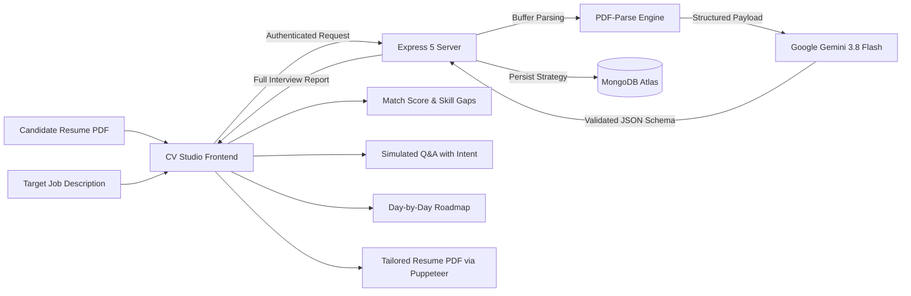

# CV Studio • AI Resume Analyzer & Interview Strategy Prep

<p align="center">
  
  
  
  
  
  
  
  
</p>

<p align="center">
  <strong>A clean, distraction-free diagnostic for professionals who value typography, structure, and high-impact interview preparation.</strong>
</p>

<p align="center">
  <a href="https://cv-analyzer-env1.onrender.com/"><strong>🌐 View Live Demo</strong></a> •
  <a href="#key-features">Key Features</a> •
  <a href="#tech-stack">Tech Stack</a> •
  <a href="#getting-started">Getting Started</a> •
  <a href="#api-reference">API Reference</a> •
  <a href="#deployment">Deployment</a> •
  <a href="#contributing">Contributing</a>
</p>

---

## Overview

**CV Studio** analyzes uploaded candidate resumes against target job descriptions using **Google Gemini 3.8 Flash**. It detects critical skill gaps, computes an objective match percentage, formulates targeted technical and behavioral interview scenarios with model-answer strategies, and constructs a customized day-by-day preparation roadmap.

All generated strategies and candidate profiles are securely stored in **MongoDB Atlas** under authenticated user accounts for sustained interview preparation.

### What the app does

1. **Upload a resume** (PDF, up to 10 MB) or paste a quick self-description.
2. **Paste a target job description.**
3. **Get an AI-generated interview strategy:** match score, skill gaps, technical + behavioral questions with interviewer intent, model-answer blueprints, and a day-by-day prep roadmap.
4. **Export a tailored resume PDF** generated on the fly with Puppeteer.
5. **Save everything** to your authenticated MongoDB Atlas account so you can revisit reports later.

---

## Key Features

- **Editorial White Aesthetic** — High-contrast, clean minimalist design with Google Fonts (`Playfair Display` + `Inter`), subtle borders, and zero clutter.
- **Instant Resume Text Extraction** — High-fidelity in-memory PDF parsing via `pdf-parse`, supporting resumes up to **10 MB**.
- **Role Alignment & Match Score** — Evaluates qualifications directly against the recruiter's job description with an algorithmic **0–100% Match Score**.
- **Technical & Behavioral Question Simulation**
  - Uncovers the **interviewer's underlying intention** behind every question.
  - Generates structured **model answer blueprints** and talking points.
- **Personalized Day-by-Day Roadmap** — Actionable, step-by-step preparation plan targeting specific candidate weaknesses.
- **Tailored Resume PDF Export** — On-the-fly tailored resume generation powered by **Puppeteer**.
- **Gated Cloud Storage** — Secure JWT authentication with HTTP-only cookies; guests are prompted to sign in so their interview plans are permanently saved to MongoDB. Includes token blacklist on logout.
- **Enterprise Resilience** — Automatic multi-model fallback (`gemini-3.8-flash` → `gemini-3.5-flash` → `gemini-3-flash-preview`) with exponential backoff against API demand spikes.

---

## Tech Stack

| Layer | Technologies |
| :--- | :--- |
| **Frontend** | React 19, Vite 7, React Router 7, Sass (SCSS), Axios |
| **Backend** | Node.js (v20+), Express 5, Multer, `pdf-parse`, Puppeteer |
| **Artificial Intelligence** | `@google/genai` (Gemini 3.8 Flash), Zod schema validation |
| **Database & Auth** | MongoDB Atlas, Mongoose ODM, JWT, `bcryptjs`, Cookie-Parser |
| **Hosting & CI/CD** | Render (Unified Full-Stack Deployment) |

---

## Architecture & Workflow



**Request lifecycle:**

1. Frontend sends `multipart/form-data` (resume PDF) + `jobDescription` (+ optional `selfDescription`) to `POST /api/interview/`.
2. Backend extracts PDF text in memory with `pdf-parse`.
3. Payload is sent to Google Gemini via `@google/genai`, validated against a Zod schema.
4. The full interview strategy is persisted to MongoDB Atlas (`interviewReports` collection).
5. Frontend renders match score, skill gaps, Q&A with intent, and the day-by-day roadmap.
6. Users can download an AI-tailored resume PDF via `POST /api/interview/resume/pdf/:id`.

---

## Project Structure

```
CV-Analyzer/
├── Backend/
│   ├── src/
│   │   ├── app.js              # Express app setup, CORS, cookies, JSON limits, SPA static serving
│   │   ├── config/
│   │   │   └── database.js     # MongoDB Atlas connection (Mongoose)
│   │   ├── controllers/
│   │   │   ├── auth.controller.js          # register / login / logout / get-me
│   │   │   └── interview.controller.js     # generate report, list reports, get report, resume PDF
│   │   ├── middlewares/
│   │   │   ├── auth.middleware.js          # JWT verification + token blacklist check
│   │   │   └── file.middleware.js          # Multer (memory storage, 10 MB limit)
│   │   ├── models/
│   │   │   ├── user.model.js               # Auth users (hashed password, JWT)
│   │   │   ├── interviewReport.model.js    # Saved AI interview strategies
│   │   │   └── blacklist.model.js          # Revoked JWTs
│   │   ├── routes/
│   │   │   ├── auth.routes.js              # /api/auth/*
│   │   │   └── interview.routes.js         # /api/interview/*
│   │   └── services/
│   │       └── ai.service.js               # Gemini report generation + Puppeteer PDF
│   ├── server.js               # Entry point: connects DB, starts Express on PORT
│   ├── .env                    # Local secrets (gitignored)
│   ├── .env.example            # Template for required environment variables
│   ├── .gitignore
│   ├── package-lock.json
│   └── package.json
├── Frontend/
│   ├── src/
│   │   ├── App.jsx
│   │   ├── app.routes.jsx      # Client-side route configuration
│   │   ├── main.jsx            # React DOM mount point
│   │   ├── style.scss          # Global typography & editorial styles
│   │   ├── features/
│   │   │   ├── auth/
│   │   │   │   ├── auth.context.jsx    # Auth state + JWT cookie management
│   │   │   │   ├── components/         # Login / Register forms
│   │   │   │   ├── hooks/              # useAuth hook
│   │   │   │   ├── pages/              # LoginPage, RegisterPage
│   │   │   │   ├── services/           # auth API client (axios)
│   │   │   │   └── auth.form.scss
│   │   │   └── interview/
│   │   │       ├── interview.context.jsx   # Report state & API actions
│   │   │       ├── hooks/                # Interview report hooks
│   │   │       ├── pages/                # Landing, Workspace, Strategy Dashboard
│   │   │       ├── services/             # interview API client (axios)
│   │   │       └── style/
│   │   └── style/button.scss
│   ├── index.html              # HTML template with Google Fonts
│   ├── .gitignore
│   ├── eslint.config.js
│   ├── index.html
│   ├── package-lock.json
│   ├── package.json
│   └── vite.config.js
├── package.json                # Root unified build & start scripts
├── render.yaml                 # Render Cloud deployment blueprint
├── .gitignore
└── README.md
```

---

## Getting Started

### Prerequisites

- [Node.js](https://nodejs.org/) v20.x or higher
- A [MongoDB Atlas](https://www.mongodb.com/atlas) cluster (free tier is sufficient)
- A [Google AI Studio API key](https://aistudio.google.com/app/apikey) with access to the Gemini models

### 1. Clone the Repository

```bash
git clone https://github.com/X-Zakariya-X/CV-Analyzer.git
cd CV-Analyzer
```

### 2. Configure Environment Variables

Create a `.env` file inside the `Backend/` directory (copy from `.env.example`):

```env
PORT=3000
NODE_ENV=development
MONGO_URI=your_mongodb_atlas_connection_string
JWT_SECRET=your_long_random_jwt_secret
GOOGLE_GENAI_API_KEY=your_google_generative_ai_api_key
FRONTEND_URL=http://localhost:5173
```

| Variable | Description | Required |
| :--- | :--- | :--- |
| `PORT` | Backend server port (default `3000`) | No |
| `NODE_ENV` | `development` or `production` | No |
| `MONGO_URI` | MongoDB Atlas connection string | **Yes** |
| `JWT_SECRET` | Secret used to sign access tokens | **Yes** |
| `GOOGLE_GENAI_API_KEY` | Google AI Studio / Gemini API key | **Yes** |
| `FRONTEND_URL` | Origin of the frontend (CORS / cookies) | No |

> 🔐 Never commit your real `.env` file. It is already covered by `Backend/.gitignore`.

### 3. Install Dependencies

From the repository root:

```bash
# Install frontend dependencies
npm --prefix Frontend install

# Install backend dependencies
npm --prefix Backend install
```

Or install both at once using the root build script:

```bash
npm run build
```

### 4. Run Locally

**Start the backend server:**
```bash
cd Backend
npm run dev        # nodemon with auto-reload
# Backend runs at http://localhost:3000
```

**Start the frontend dev server:**
```bash
cd Frontend
npm run dev        # Vite dev server with HMR
# Frontend runs at http://localhost:5173
```

Open `http://localhost:5173` in your browser. Register an account, upload a resume, paste a job description, and generate your interview strategy.

---

## API Reference

Base URL (local): `http://localhost:3000`

### Authentication Routes (`/api/auth`)

| Method | Endpoint | Description | Access | Body |
| :--- | :--- | :--- | :--- | :--- |
| `POST` | `/api/auth/register` | Register a new user | Public | `{ name, email, password }` |
| `POST` | `/api/auth/login` | Authenticate user & set HTTP-only cookie | Public | `{ email, password }` |
| `GET` | `/api/auth/logout` | Clear token & blacklist the JWT | Authenticated | — |
| `GET` | `/api/auth/get-me` | Get current authenticated user profile | Authenticated | — |

### Interview & Analysis Routes (`/api/interview`)

| Method | Endpoint | Description | Access |
| :--- | :--- | :--- | :--- |
| `POST` | `/api/interview/` | Upload resume PDF + generate interview strategy | Authenticated |
| `GET` | `/api/interview/` | List all saved reports for the logged-in user | Authenticated |
| `GET` | `/api/interview/report/:id` | Fetch a specific interview strategy by ID | Authenticated |
| `POST` | `/api/interview/resume/pdf/:id` | Download AI-tailored resume as PDF | Authenticated |

#### Example: Generate Interview Report

```http
POST /api/interview/
Content-Type: multipart/form-data
Cookie: token=<jwt>

form fields:
- resume: <File> (PDF, max 10 MB)
- jobDescription: "Senior Frontend Engineer ..."
- selfDescription: "Optional quick self-description"
```

#### Example: Tailored Resume PDF

```http
POST /api/interview/resume/pdf/64a7f1...
Cookie: token=<jwt>

Response: application/pdf (attachment; filename=resume_<id>.pdf)
```

All authenticated routes require a valid JWT stored in an HTTP-only `token` cookie. Logout blacklists the token so it cannot be reused.

---

## AI & Core Logic

### Generated Interview Strategy

Each report includes:
- **Match Score** (0–100 %) — alignment between the resume/self-description and the target job description.
- **Skill Gaps** — missing or under-represented competencies relative to the role.
- **Technical Questions** — role-specific questions with interviewer intent + model answer blueprints.
- **Behavioral Questions** — situational/leadership questions with intent + talking points.
- **Preparation Plan** — a day-by-day, actionable roadmap targeting the candidate's weaknesses.

### Resilience & Fallbacks

The backend chains Gemini models automatically under load:
```
gemini-3.8-flash  →  gemini-3.5-flash  →  gemini-3-flash-preview
```
Exponential backoff is applied between retries to survive API demand spikes.

### Tailored Resume PDF

When requested, the server regenerates a resume PDF with Puppeteer using the original resume text, job description, and self-description, optimized for the target role. The response is streamed as `application/pdf`.

---

## Deployment (Render)

The project is pre-configured for single-service full-stack deployment on **[Render.com](https://render.com)** via `render.yaml`.

### Deploy in 5 steps

1. Push this repository to your GitHub account.
2. In Render, create a **New Web Service** and connect the repository.
3. Configure the service:
   - **Runtime:** Node
   - **Build Command:** `npm --prefix Frontend install --include=dev && npm --prefix Frontend run build && npm --prefix Backend install`
   - **Start Command:** `npm start`
4. Add the following **Environment Variables** in the Render dashboard:
   - `NODE_ENV` = `production`
   - `MONGO_URI` = your MongoDB Atlas URI
   - `JWT_SECRET` = a secure random string (Render can auto-generate this)
   - `GOOGLE_GENAI_API_KEY` = your Google AI Studio key
   - `FRONTEND_URL` = your Render service URL (e.g. `https://cv-studio.onrender.com`)
5. In **MongoDB Atlas → Network Access**, add `0.0.0.0/0` (Allow Access from Anywhere) so Render can connect to your cluster.

The root `package.json` handles the unified build:
- `npm run build` — installs & builds the Vite frontend, then installs backend dependencies
- `npm start` — runs `node Backend/server.js` (Express serves the built SPA statically in production)

---

## Available Scripts

### Root (`package.json`)

| Script | Purpose |
| :--- | :--- |
| `npm run build` | Install frontend (incl. devDeps), build Vite production bundle, install backend |
| `npm start` | Start the Express backend (`node Backend/server.js`) |

### Backend (`Backend/package.json`)

| Script | Purpose |
| :--- | :--- |
| `npm run dev` | Start with `nodemon` for auto-reload during development |
| `npm start` | Start production server (`node server.js`) |
| `npm test` | No tests configured |

### Frontend (`Frontend/package.json`)

| Script | Purpose |
| :--- | :--- |
| `npm run dev` | Start Vite dev server with HMR |
| `npm run build` | Build production bundle to `dist/` |
| `npm run lint` | Run ESLint |
| `npm run preview` | Preview the production build locally |

---

## Troubleshooting

| Issue | Likely Cause | Fix |
| :--- | :--- | :--- |
| `MongoServerSelectionError` | MongoDB Atlas IP allowlist blocks Render | Add `0.0.0.0/0` in Atlas Network Access |
| CORS errors in browser | `FRONTEND_URL` mismatch or missing cookie config | Set `FRONTEND_URL` to your frontend origin; ensure `cookie-parser` + CORS credentials are enabled |
| Puppeteer fails on Render | Missing Chrome dependencies | Render's Node image includes required libs; if self-hosting, install `puppeteer` system dependencies |
| PDF text extraction fails | Scanned/image-only PDF | Upload a text-based PDF or use the Quick Self-Description field instead |
| `JWT_SECRET` missing | `.env` not created | Copy `Backend/.env.example` to `Backend/.env` and fill in values |

---

## Contributing

Contributions are welcome! To contribute:

1. Fork the repository.
2. Create a feature branch: `git checkout -b feature/your-feature-name`
3. Commit your changes: `git commit -m "feat: add your feature"`
4. Push to the branch: `git push origin feature/your-feature-name`
5. Open a Pull Request against `main`.

Please keep commits conventional (`feat:`, `fix:`, `chore:`, `docs:`) and match the existing code style (Prettier-ish formatting, 4-space indentation).

---

## License

Distributed under the **MIT License**. See [LICENSE](LICENSE) for more information.

---

<p align="center">
  Crafted with care for ambitious professionals preparing for high-impact roles.<br>
  <strong>CV Studio</strong> • <a href="https://github.com/X-Zakariya-X/CV-Analyzer">GitHub</a>
</p>
